<div align="center">

# Perchbot

[](https://www.npmjs.com/package/perchbot)
[](https://www.npmjs.com/package/perchbot)
[](https://github.com/kadirdemirkaya/perchbot/blob/main/LICENSE)

**A little desktop robot that lets you watch Claude Code work in the background, and makes it fun.**

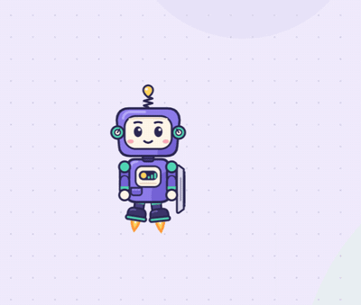

</div>

Perchbot lives in a corner of your screen and acts out what the agent is doing: it thinks, reads,
types, runs commands, waits for you and cheers when the work is done. Sub-agents show up as little
helpers, a failing test brings a bug to fight, and between tasks it plays on its own.
It runs on your computer and sends nothing anywhere.

<sub>Unofficial; not affiliated with or endorsed by Anthropic. Claude and Claude Code are trademarks of Anthropic.</sub>

## Install

Needs Node.js 20+ and Claude Code.

```sh
npm install -g perchbot
perchbot setup        # adds the hooks to every Claude Code account on this computer
```

The first `perchbot setup` also downloads Electron, the window the robot lives in (about 100 MB, once).
Restart open sessions (VS Code: *Developer: Reload Window*) and the robot shows up with your next prompt.
`perchbot demo` plays every state without an agent. From a clone: `npm install`, then `npm run setup`.

## What it does

| When | The robot |
|---|---|
| the agent thinks, reads, searches, edits or runs a command | takes a pose for each step and says what it is on ("Editing auth.js") |
| the agent waits for you | nudges you, then knocks until you answer |
| a turn ends | cheers, with a short summary ("Done! 4 steps in 12 s"); on Friday afternoons it dances |
| a long turn ends while you look elsewhere | flies over to your cursor (even on another screen): "All done! Over to you.", then back |
| sub-agents start | little helpers join in, work beside it, chat, play tag, build towers, poke your resting cursor and report back |
| a skill is in use | reads its skill book, the skill's name on a tag |
| a test or check fails | a bug turns up and they fight until a check passes ("Bug fixed!") |
| a commit, a push | plants a flag, launches a rocket |
| checks keep failing | sweats, then "Phew!" when it is green again |
| the work gets intense | puts on a headband and codes on a screen of light |
| you tap it | loves it, up to a point: then it fumes, catches fire and goes on a rampage across your screen |
| you start a duel | a sword fight against your cursor, three hearts each |
| it is idle | backflips, moonwalks, blows bubbles, throws paper planes, gets visitors, plays with its cat, flies off now and then and carries on wherever it lands, has a coffee in the morning, naps (in a nightcap late at night) |
| the cursor rests somewhere | now and then it flies over for a look through its magnifier |
| you type in a terminal (Windows, opt-in) | now and then it flies over, reads along above the line, and a light bulb goes on: got it! |
| you open the chat | answers questions about the work; on Windows (opt-in) it opens Chrome, a tab or YouTube for you |

## See it in action

<table>
  <tr>
    <td align="center">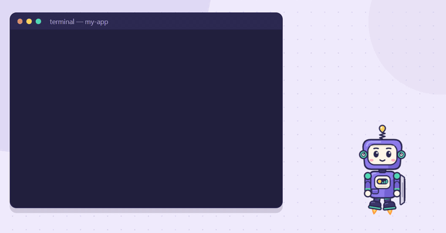<br><sub><b>At work:</b> reading, searching, editing, testing</sub></td>
    <td align="center">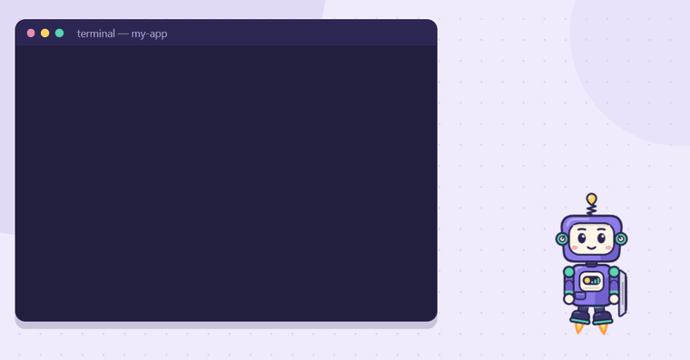<br><sub><b>Sub-agents</b> join in, chat and report back</sub></td>
  </tr>
  <tr>
    <td align="center">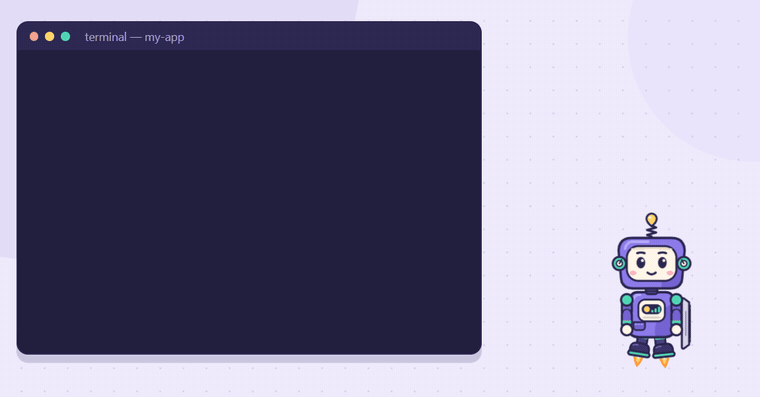<br><sub><b>A skill:</b> out comes the skill book</sub></td>
    <td align="center">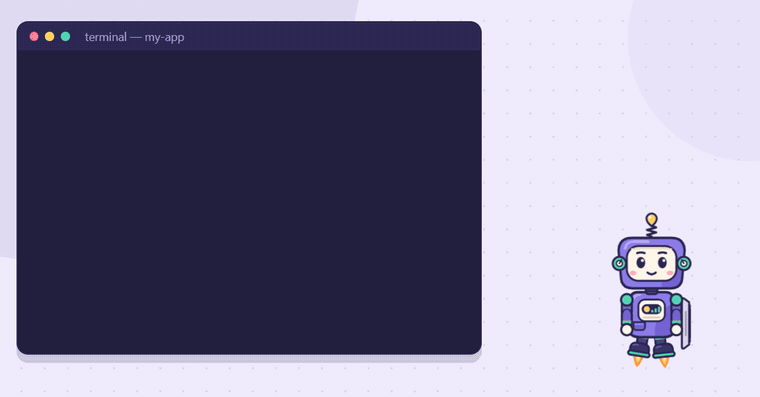<br><sub><b>Bug hunt:</b> a failing test brings a bug</sub></td>
  </tr>
  <tr>
    <td align="center">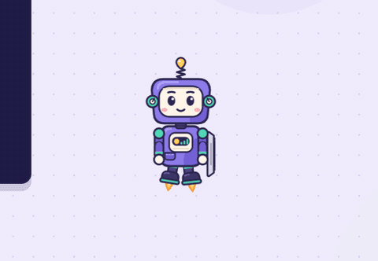<br><sub><b>Too many taps:</b> fuming, then fire</sub></td>
    <td align="center">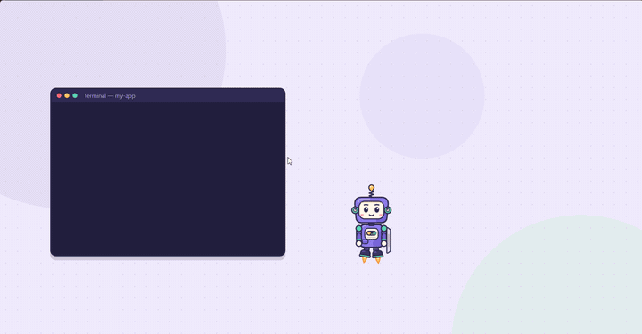<br><sub><b>Rampage:</b> lasers, missiles, then your cursor</sub></td>
  </tr>
  <tr>
    <td align="center">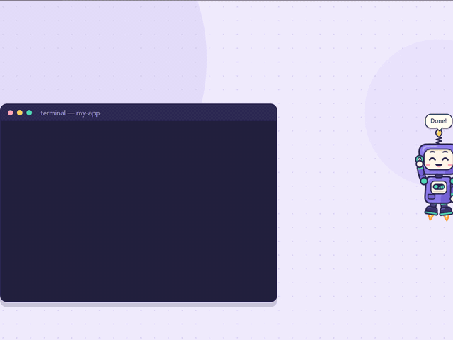<br><sub><b>Hanging around</b> at the top of the screen</sub></td>
    <td align="center">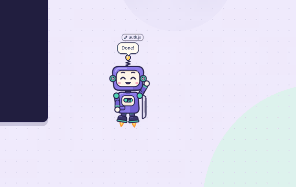<br><sub><b>Sword duel</b> against your cursor</sub></td>
  </tr>
  <tr>
    <td align="center"><br><sub><b>Waiting for you:</b> a psst, then a knock</sub></td>
    <td align="center"><br><sub><b>Compaction</b> squeezes its head, <b>/exit</b> waves goodbye</sub></td>
  </tr>
  <tr>
    <td align="center">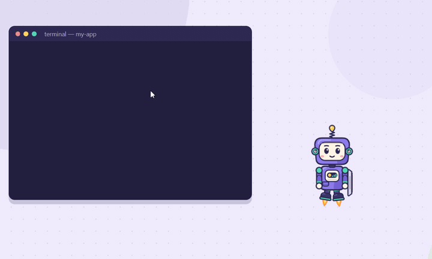<br><sub><b>Done while you looked away:</b> it flies over to tell you</sub></td>
    <td align="center">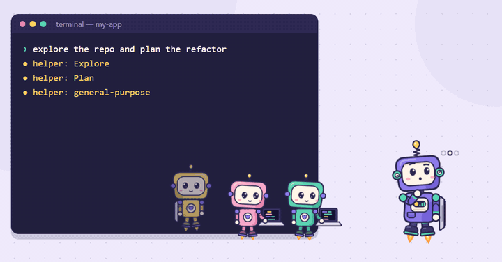<br><sub><b>Helpers at play:</b> tag, a tower, a poke at your cursor</sub></td>
  </tr>
  <tr>
    <td align="center" colspan="2">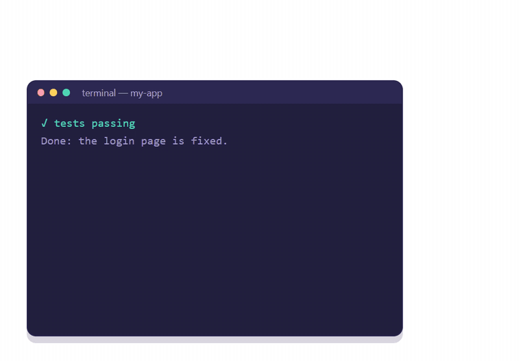<br><sub><b>Watch me type</b> (Windows, opt-in): it reads along, then "Aha! Got it!"</sub></td>
  </tr>
  <tr>
    <td align="center" colspan="2">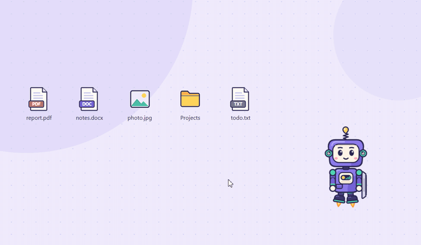<br><sub><b>Follow Windows</b> (Windows, opt-in): delete a file and it slashes its ghost, coloured by type</sub></td>
  </tr>
</table>

<details>
<summary><b>More animations</b></summary>
<br>
<table>
  <tr>
    <td align="center">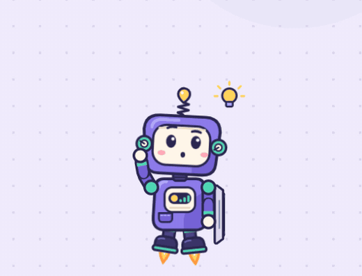<br><sub><b>Focus mode</b> when the work gets intense</sub></td>
    <td align="center">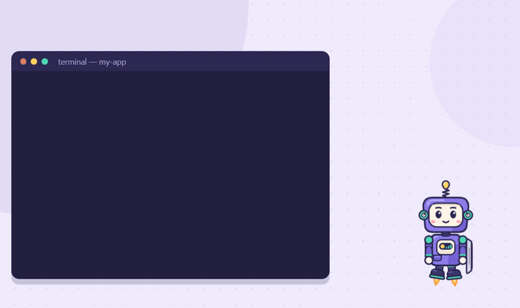<br><sub><b>Commit, push, sweat, phew</b></sub></td>
  </tr>
  <tr>
    <td align="center">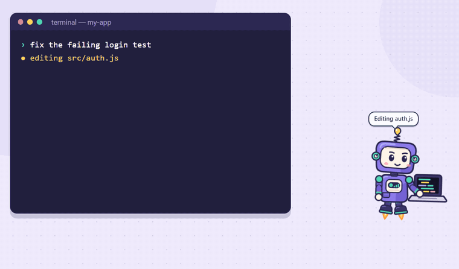<br><sub><b>Chat:</b> ask what it is doing</sub></td>
    <td align="center">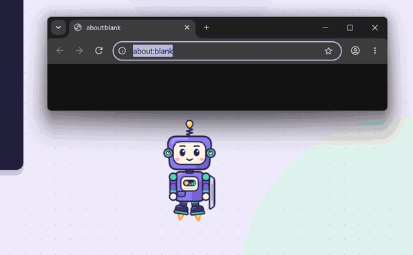<br><sub><b>Rocket fist:</b> a new tab, from afar</sub></td>
  </tr>
  <tr>
    <td align="center">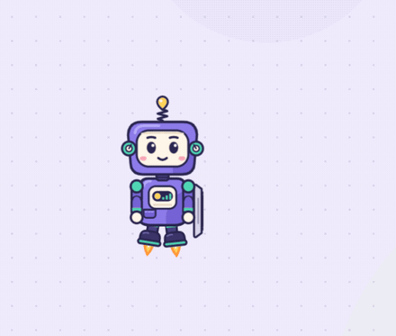<br><sub><b>A few taps</b> when it is idle: "Hehe!"</sub></td>
    <td align="center">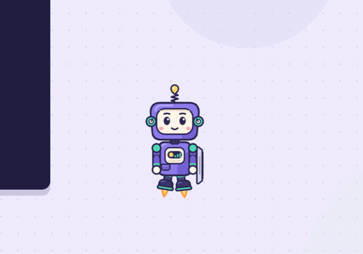<br><sub><b>Idle plays:</b> flips, bubbles, a paper plane</sub></td>
  </tr>
  <tr>
    <td align="center">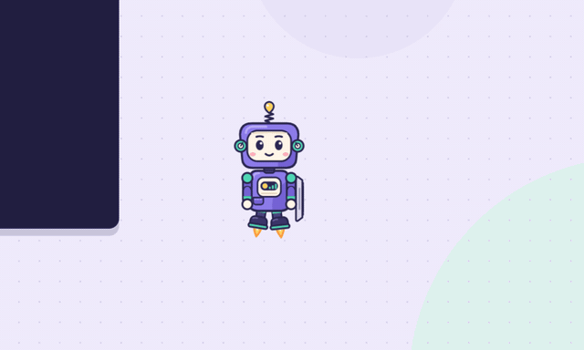<br><sub><b>A visitor</b> drops by for sword practice</sub></td>
    <td align="center">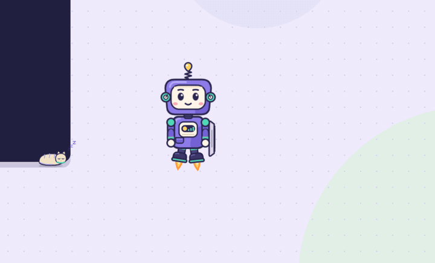<br><sub><b>The cat:</b> laser pointer, then a cuddle</sub></td>
  </tr>
  <tr>
    <td align="center">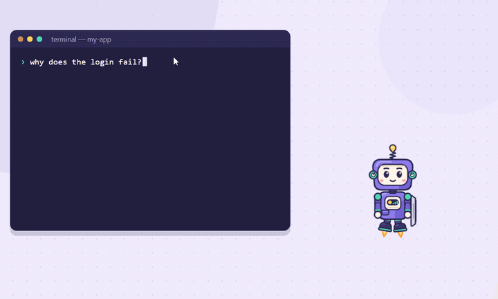<br><sub><b>Curious:</b> a look where your cursor rests</sub></td>
    <td align="center">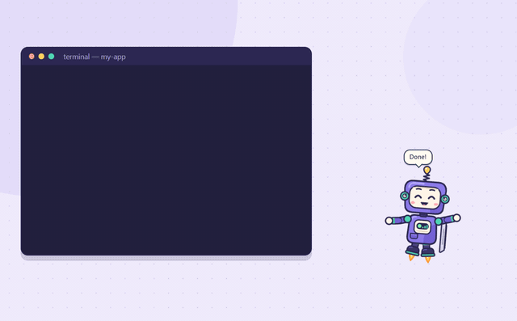<br><sub><b>Flying:</b> a loop-the-loop, a slow cruise</sub></td>
  </tr>
  <tr>
    <td align="center">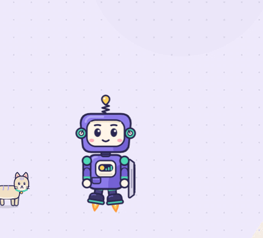<br><sub><b>Curious:</b> "What's this?", then "Welcome back!"</sub></td>
    <td align="center">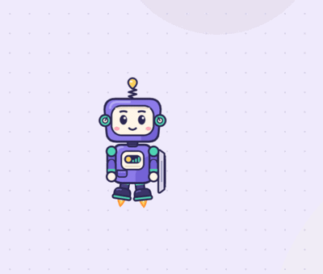<br><sub><b>Little plays:</b> stretch, hum, ball, reboot, polish</sub></td>
  </tr>
  <tr>
    <td align="center">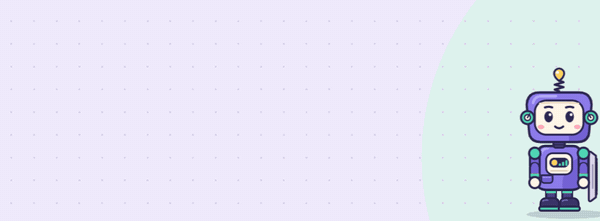<br><sub><b>Ambient life:</b> a walk, a sit, the cat</sub></td>
    <td align="center">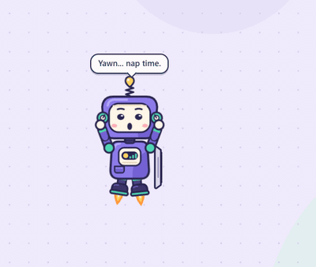<br><sub><b>Nap time</b> after a long idle spell</sub></td>
  </tr>
  <tr>
    <td align="center" colspan="2">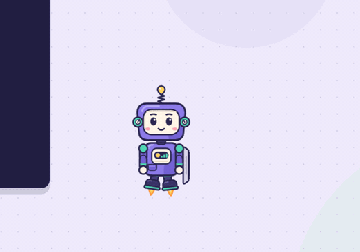<br><sub><b>By the clock:</b> a morning coffee, a Friday dance, a nightcap at night</sub></td>
  </tr>
  <tr>
    <td align="center" colspan="2">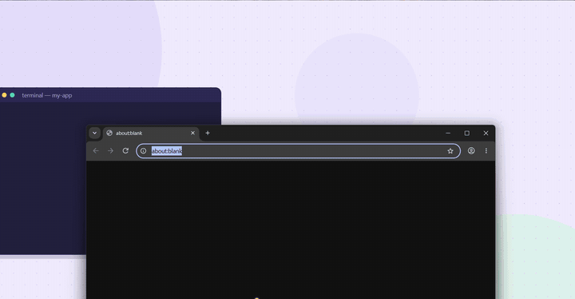<br><sub><b>Perching</b> on a window's title bar, riding along when it moves (Windows)</sub></td>
  </tr>
</table>
</details>

## Using it

- **Hover** it for its menu, **drag** it anywhere, **right-click** it to walk, fly, duel or call the cat.
  Everything else is in the tray icon.
- **Quiet mode** hides file names and commands: handy while you share your screen.
- **Ambient life** (tray) lets it and its helpers roam your screens when idle; **Stay here** keeps it on its spot.
- **Several accounts** (`CLAUDE_CONFIG_DIR`)? Tray > Account > *One buddy per account* gives each one its own robot.
- **Sound** (tray, off by default): little robot sounds made in code, no audio files.
- **Hands** (Windows, tray, off by default): Chrome, tab and YouTube buttons in the chat panel. It presses
  them through Windows UI Automation; your mouse is not moved, tab titles and addresses are not read.
- **Watch me type** (Windows, tray, off by default; needs ambient life): while you type in a terminal
  (Windows Terminal or the classic console), it comes over now and then (at most once a minute) to read
  along, then a light bulb goes on. It only asks Windows where the text cursor is: never what you type.
- **Follow Windows** (Windows, last button of the hover menu, off by default): when you delete a file or a
  folder in Windows (it goes to the Recycle Bin), it comes over and slashes a ghost of it with its sword,
  coloured by type. It deletes nothing itself. Shift+Delete and command-line deletes skip the Recycle Bin,
  so it does not see those; while Claude Code is working it lets deletes go.

## Commands

| | |
|---|---|
| `perchbot setup` | add the hooks (`~/.claude`, `~/.claude-<name>`, `$CLAUDE_CONFIG_DIR`); asks once, backs up each file |
| `perchbot doctor` | fix missing hooks, test each account live (`--account <name>` for one) |
| `perchbot status` | which accounts have the hooks, is the robot running (`--config-dir <dir>` for one) |
| `perchbot start` | start the robot now |
| `perchbot demo` | a tour of every state, no agent needed |
| `perchbot uninstall` | remove the hooks again |

## Privacy

Only the event, the tool name, a file name (not the path) and a shortened command (secrets masked)
leave the hook, and only to `127.0.0.1`. With ambient life on, the robot also looks at the system idle
time, where the cursor is (its position only) and, on Windows, where windows are (frames only, never
titles or contents). With *Watch me type* on, it also asks Windows where the text cursor of the terminal
in front is: a position only, never the text, never your keys, nothing in password fields. With *Follow
Windows* on, it watches your Recycle Bin for new deletes and takes only the type of each item (its
extension, or that it was a folder): never its name or where it was. Nothing of it is stored or sent anywhere. Settings: `~/.perchbot/settings.json`.
The only download is Electron itself: once, by `perchbot setup` (or `start` / `demo` while it is still
missing), with Electron's own installer. The robot never goes online.

## Development

`npm test` · `npm run dev` · `npm run simulate [-- bug | life | chat]` · `npm pack`.
Make your own character: [characters/README.md](https://github.com/kadirdemirkaya/perchbot/blob/main/characters/README.md).

MIT, see [LICENSE](https://github.com/kadirdemirkaya/perchbot/blob/main/LICENSE) and [THIRD_PARTY_NOTICES.md](https://github.com/kadirdemirkaya/perchbot/blob/main/THIRD_PARTY_NOTICES.md).
